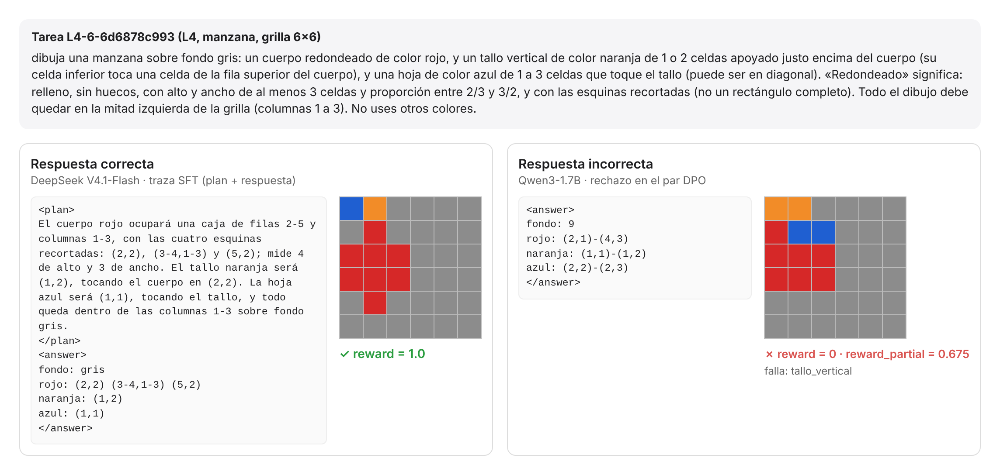

# PixelDraw

**Un entorno para entrenar a un LLM pequeño a dibujar en grillas a partir de texto, con recompensa verificable.**

El modelo recibe una especificación ("dibuja una manzana sobre fondo gris, con el cuerpo rojo...") y responde con las celdas que pinta. Un verificador escrito en código revisa formas, posiciones, relaciones y conceptos, sin clasificador de imágenes, y devuelve la recompensa. Cualquier dibujo que cumpla la especificación recibe 1.0.



*La misma tarea de L4 con dos respuestas reales. A la izquierda, DeepSeek V4.1-Flash (una traza SFT); a la derecha, Qwen3-1.7B (el rechazo de un par DPO). Al 1.7B le falta una sola restricción, el tallo vertical, y recibe crédito parcial.*

Proyecto del Desafío de Investigación de IIC-3694 Inteligencia Artificial Generativa (PUC Chile, 2026).

## Cómo funciona

1. **Prompt.** Trae la paleta de 10 colores, la numeración de filas y columnas, la tarea y un ejemplo del formato de respuesta. El ejemplo corresponde a otro dibujo, y copiarlo da recompensa 0.
2. **Respuesta.** Va dentro de `<answer>`: una línea con el fondo y una línea por color con sus celdas, admitiendo tramos.
   ```
   <answer>
   fondo: gris
   rojo: (2,2) (3-4,1-3) (5,2)
   naranja: (1,2)
   </answer>
   ```
3. **Parser.** Toma el último `<answer>` e ignora el contenido de `<think>`. Acepta sintaxis equivalentes: grilla densa de índices, JSON, colores en femenino o plural, índices en vez de nombres, rectángulos de esquina a esquina `(f1,c1)-(f2,c2)` y comentarios.
4. **Verificador.** Revisa las restricciones de la tarea sobre la grilla: componentes conexas, formas exactas, relaciones espaciales, conteos, simetría y la gramática de cada concepto.
5. **Recompensa.**
   - `reward` es binaria: 1.0 si se cumplen todas las restricciones.
   - `reward_partial` da señal densa para GRPO: crédito por restricciones cumplidas, normalizado contra la mejor grilla de un solo color y con tope de 0,9 para respuestas no resueltas.

## Instalación

Solo hace falta Python 3.10 o superior. El entorno no tiene dependencias externas.

```bash
git clone <url-del-repo> pixeldraw
cd pixeldraw
pip install -e ".[dev]"          # opcional: instala pytest y los comandos pixeldraw-*
python -m pytest                 # pruebas rápidas
```

Para usarlo sin instalar nada, basta correr los comandos desde la raíz del repo con `python -m pixeldraw.<herramienta>`.

Requisitos opcionales:
- `matplotlib`, para las figuras PNG de `pixeldraw.render` (`pip install -e ".[figuras]"`).
- Un servidor compatible con la API de OpenAI (por ejemplo `llama serve` de llama.cpp), para medir modelos.
- [OpenCode](https://opencode.ai), para modelos que solo están disponibles ahí.

## Uso

### Recompensa (interfaz del curso)

```python
from pixeldraw import load_tasks, reward, reward_partial, verify

tasks = load_tasks("data/train.jsonl")   # registra las tareas; reward las busca por el prompt
t = tasks[0]

reward(t["prompt"], completion)          # 1.0 o 0.0
reward_partial(t["prompt"], completion)  # entre 0.0 y 1.0
verify(t["spec"], completion)            # detalle: cada restricción, crédito parcial, error de parseo
```

- `reward` busca la especificación de la tarea a partir del prompt, así que antes hay que cargar las tareas, con `load_tasks` o con la variable de entorno `PIXELDRAW_TASKS=data/train.jsonl`.
- El prompt puede ser un texto o una lista de mensajes de chat; en ese caso se usa el último mensaje del usuario.

Ejemplo con la tarea `L1-6-d221115c34` de eval (rectángulo morado de 4 filas × 2 columnas con su esquina superior izquierda en (3,4), sobre fondo blanco):

| Respuesta | `reward` |
|---|---:|
| `fondo: blanco` / `morado: (3-6,4-5)` | 1.0 |
| `fondo: blanco` / `morada: (3,4)-(6,5)` | 1.0 |
| La misma grilla en formato denso (seis filas de índices) | 1.0 |
| `fondo: blanco` / `morado: (3-6,4)` (falta una columna) | 0.0 |

### Herramientas

| Comando | Para qué |
|---|---|
| `python -m pixeldraw.generate --mode full --out-dir data/` | Genera los splits |
| `python -m pixeldraw.probe` | Mide pass@1 y pass@k de un modelo servido con una API compatible con OpenAI |
| `python -m pixeldraw.probe_opencode` | Lo mismo, para modelos a los que solo se accede por OpenCode |
| `python -m pixeldraw.derive` | Construye las trazas SFT y los pares DPO a partir de corridas sobre train |
| `python -m pixeldraw.report` | Tablas de línea base y calibración en Markdown y LaTeX |
| `python -m pixeldraw.render` | Galería HTML con los dibujos de cada modelo y su veredicto |
| `python -m tests.verifier_suite data/eval.jsonl` | Batería completa del verificador sobre un split |

Cada comando acepta `--help`. Por ejemplo, para medir Qwen3-1.7B servido con llama.cpp:

```bash
llama serve -m Qwen3-1.7B-Q8_0.gguf --port 8080 -np 8 -c 65536
python -m pixeldraw.probe --tasks data/eval.jsonl --base-url http://localhost:8080/v1 \
    --model qwen3-1.7b --k 4 --per-cell 10 --max-tokens 6000 --temperature 1.0 \
    --out results/eval/mi_corrida.jsonl
```

La salida trae pass@1 y pass@k por nivel, tamaño y familia, la fracción de tareas en zona aprendible y las restricciones que más fallan. Si la corrida se interrumpe, al relanzar el mismo comando sigue donde quedó.

## Estructura del repositorio

```
pixeldraw/              el entorno (paquete de Python)
  core.py               paleta, formas, relaciones y gramáticas de los conceptos
  verifier.py           parser, verificador y recompensas (reward, reward_partial, verify)
  generate.py           generador de tareas
  probe.py              evaluación con una API compatible con OpenAI
  probe_opencode.py     evaluación a través de OpenCode
  derive.py             trazas SFT y pares DPO
  report.py, render.py  tablas y galerías
  utils.py, provenance.py
tests/                  batería del verificador y pruebas unitarias
data/                   tareas: train, eval, test, test_ood
derived/                datos derivados: sft.jsonl, dpo.jsonl
results/eval/           corridas de la línea base sobre eval
results/train/          corridas sobre train de las que salen los datos derivados
docs/                   detalles técnicos y la figura de ejemplo
```

**Los archivos `.jsonl`.** Todos tienen un objeto JSON por línea.

| Archivo | Cada línea es | Para qué sirve |
|---|---|---|
| `data/*.jsonl` | Una tarea: `prompt`, `spec` (las restricciones), `reference` (un dibujo válido), `level`, `size`, `family`, `split` | La entrada de todo lo demás: entrenamiento, evaluación y recompensa |
| `derived/sft.jsonl` | Una conversación (`messages`) con el prompt y una respuesta correcta del profesor | Ajuste supervisado (SFT) |
| `derived/dpo.jsonl` | Un par `prompt` / `chosen` / `rejected` | DPO u otros métodos de preferencias |
| `results/**/*.jsonl` | Una respuesta de un modelo a una tarea, con su texto completo y su veredicto | Reproducir la línea base y los datos derivados. Cada uno tiene al lado un `.manifest.json` con el comando y los parámetros |

## Dataset

Son 9.798 tareas generadas por código, en seis niveles y tres tamaños de grilla (6, 8 y 12).

| Nivel | Qué pide | Ejemplo (enunciados de eval, abreviados) |
|---|---|---|
| L0 | Rellenos: mitades, franjas, borde | "pinta la mitad izquierda de la grilla de gris y la mitad derecha de verde" |
| L1 | Una forma en una posición exacta | "un rectángulo relleno de 4 filas × 2 columnas de color morado, con su esquina superior izquierda en la fila 3, columna 4" |
| L2 | 2–3 formas con relaciones | "una línea vertical azul de 2 celdas y un cuadrado negro de 2×2 que no se toquen, ni siquiera en diagonal" |
| L3 | Conteos, simetría, pares | "exactamente 3 puntos rojos que no se toquen, ni siquiera en diagonal" |
| L4 | Concepto con receta explícita | La manzana de la figura de arriba |
| L5 | Concepto sin receta | "dibuja una casa reconocible sobre fondo gris, en la mitad izquierda de la grilla; elige tú los colores" |

| Split | Tareas | Uso |
|---|---:|---|
| `train` | 6.139 | Entrenamiento y generación de trazas |
| `eval` | 738 | Validación y línea base |
| `test` | 1.471 | Prueba final |
| `test_ood` | 1.450 | Grillas de 10×10 y 16×16 y un concepto nuevo (sol) |

- Ningún enunciado se repite entre splits; la deduplicación ignora el ejemplo de formato.
- De eval, test y test_ood se quitaron las tareas usadas para ajustar el verificador (`data/limpieza.json`).
- Los archivos de `data/` son la versión canónica. Regenerarlos con el código actual da las mismas tareas de L0–L4, pero no las de L5. El generador elige el ejemplo de formato con el verificador, y el verificador de L5 cambió después de generar los splits.

## Datos derivados

| Archivo | Contenido | Origen |
|---|---|---|
| `derived/sft.jsonl` | 1.001 trazas: plan breve y respuesta | DeepSeek V4.1-Flash (pesos abiertos) sobre train. Solo respuestas correctas, sin truncar y sin duplicados |
| `derived/dpo.jsonl` | 574 pares preferida / rechazada | Preferida de DeepSeek y rechazada de Qwen3-1.7B, priorizando los rechazos casi correctos |

Para regenerarlos:

```bash
python -m pixeldraw.derive --tasks data/train.jsonl \
    --results results/train/deepseek-v4.1-flash_L2-L5.jsonl results/train/deepseek-v4.1-flash_L0-L1.jsonl \
              results/train/qwen3-1.7b_think_L2-L5.jsonl results/train/qwen3-1.7b_think_L0-L1.jsonl \
    --sft-models opencode-go/deepseek-v4.1-flash --out-dir derived/
```

## Línea base (eval, pass@1 %)

| Nivel | Qwen3-1.7B sin razonamiento | Qwen3-1.7B con razonamiento | DeepSeek V4.1-Flash |
|---|---:|---:|---:|
| L0 | 0,4 | 60,0 | 100 |
| L1 | 45,4 | 81,7 | 98,3 |
| L2 | 3,3 | 35,8 | 100 |
| L3 | 19,6 | 50,8 | 100 |
| L4 | 0 | 0 | 100 |
| L5 | 0 | 0 | 81,2 |

- Hay 30 tareas por nivel (8 en L5) y k = 8, 4 y 2 muestras por tarea, respectivamente.
- Las tablas completas (pass@k, crédito parcial, truncamiento y calibración) se reproducen con:

```bash
python -m pixeldraw.report --tasks data/eval.jsonl \
    --run "Qwen3-1.7B sin razonamiento=results/eval/qwen3-1.7b_nothink.jsonl" \
          "Qwen3-1.7B con razonamiento=results/eval/qwen3-1.7b_think.jsonl" \
          "DeepSeek V4.1-Flash=results/eval/deepseek-v4.1-flash.jsonl" \
    --k 2 4 8 --families
```

## Robustez y calibración

- **Robustez.** `python -m tests.verifier_suite data/eval.jsonl` corre 83.228 casos sin fallas:
  - formatos equivalentes que deben aceptarse;
  - mutaciones que deben fallar;
  - casos adversariales: varias respuestas, inyecciones, la solución escondida en `<think>`, copiar el ejemplo del prompt y otros;
  - 24 dibujos reales revisados a mano.

  Ninguna estrategia trivial obtiene crédito parcial. Sobre `test_ood` son 163.954 casos, también sin fallas.
- **Calibración.** Con razonamiento, entre 27% y 60% de las tareas de L0–L3 las resuelve el 1.7B solo a veces: es la zona donde GRPO tiene señal. L4–L5 quedan en 0%, así que necesitan SFT antes de RL.

## Fortalezas y limitaciones

- **Fortalezas:**
  - recompensa sin modelos aprendidos, incluso para conceptos visuales;
  - respuestas abiertas desde L2;
  - dificultad graduable por nivel y por tamaño;
  - un verificador probado con respuestas reales de los modelos.
- **Limitaciones:**
  - L5 tiene pocos enunciados distintos (8 tareas en eval);
  - "redondeado" es una convención geométrica;
  - hay pocos conceptos (cuatro en L5);
  - DeepSeek resuelve casi todo L0–L4, así que para comparar modelos grandes conviene usar L5 y `test_ood`.

Los detalles de diseño (formato, parser, crédito parcial, tests y decisiones del verificador) están en [docs/DETALLES.md](docs/DETALLES.md).
