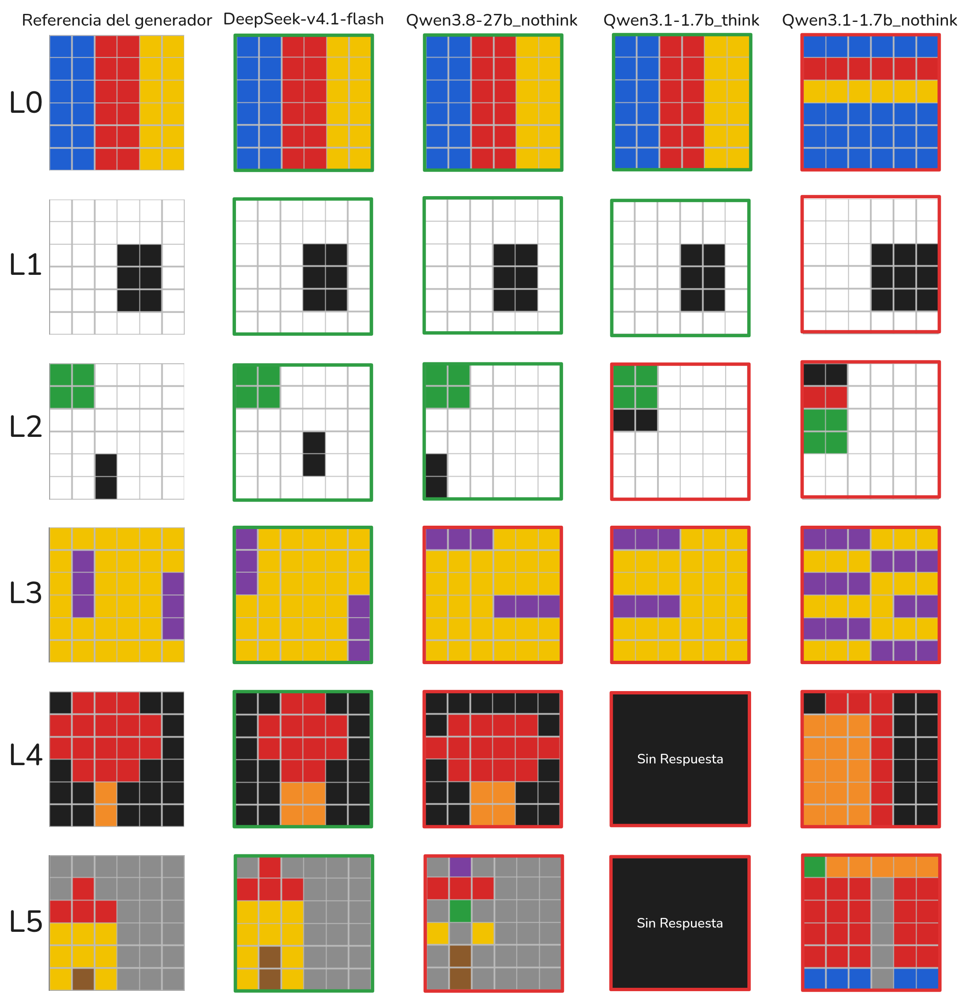

# PixelDraw

**Un entorno para entrenar a un LLM pequeño a dibujar en grillas a partir de texto, con recompensa verificable.**

El modelo recibe una especificación ("dibuja una manzana sobre fondo gris, con el cuerpo rojo...") y responde con las celdas que pinta. Un verificador escrito en código revisa formas, posiciones, relaciones y conceptos, sin clasificador de imágenes, y devuelve la recompensa. Cualquier dibujo que cumpla la especificación recibe 1.0.



*En la imagen se ven ejemplos con los distintos niveles de dificultad, desde L0 (rellenos) hasta L5 (conceptos sin receta). La primera columna muestra la referencia, la segunda columna la respuesta del modelo DeepSeek V4.1-Flash (una traza SFT), la tercera columna la respuesta de Qwen3.8-27b_nothink, la cuarta y quinta columna la respuesta de Qwen3-1.7B con y sin razonamiento, respectivamente. Los marcos denotan el resultado del verificador (verde correcto, rojo incorrecto). Al final se encuentran los prompts.*

## Cómo funciona

1. **Prompt.** Trae la paleta de 10 colores, la numeración de filas y columnas, la tarea y un ejemplo del formato de respuesta. El ejemplo corresponde a otro dibujo, y copiarlo da recompensa 0.
2. **Respuesta.** Va dentro de `<answer>`: una línea con el fondo y una línea por color con sus celdas, admitiendo tramos.
   ```
   <answer>
   fondo: gris
   rojo: (2,2) (3-4,1-3) (5,2)
   naranja: (1,2)
   </answer>
   ```
3. **Parser.** Toma el último `<answer>` e ignora el contenido de `<think>`. Acepta sintaxis equivalentes: grilla densa de índices, JSON, colores en femenino o plural, índices en vez de nombres, rectángulos de esquina a esquina `(f1,c1)-(f2,c2)` y comentarios.
4. **Verificador.** Revisa las restricciones de la tarea sobre la grilla: componentes conexas, formas exactas, relaciones espaciales, conteos, simetría y la gramática de cada concepto. Por temas de eficiencia es que no se utiliza un clasificador de imágenes. 
5. **Recompensa.**
   - `reward` es binaria: 1.0 si se cumplen todas las restricciones.
   - `reward_partial` da señal densa para GRPO: crédito por restricciones cumplidas, normalizado contra la mejor grilla de un solo color y con tope de 0,9 para respuestas no resueltas.

## Instalación

Solo hace falta Python 3.10 o superior. El entorno no tiene dependencias externas.

```bash
git clone <url-del-repo> pixeldraw
cd pixeldraw

# Crear un entorno virtual (opcional pero recomendado), en este caso yo utilizo uv
# curl -LsSf https://astral.sh/uv/install.sh | sh
uv venv --python 3.11
source .venv/bin/activate

uv pip install -e ".[dev]"       # opcional: instala pytest y los comandos pixeldraw-*
python -m pytest                 # pruebas rápidas
```

Para usarlo sin instalar nada, basta correr los comandos desde la raíz del repo con `python -m pixeldraw.<herramienta>`.

Requisitos opcionales:
- `matplotlib`, para las figuras PNG de `pixeldraw.render` (`uv pip install -e ".[figuras]"`).
- Un servidor compatible con la API de OpenAI (por ejemplo `llama serve` de llama.cpp), para medir modelos.
- [OpenCode](https://opencode.ai), para modelos que solo están disponibles ahí. En este caso en particular, se utilizó `opencode-go/deepseek-v4.1-flash` para generar las trazas SFT y los pares DPO.

## Uso

### Recompensa

```python
from pixeldraw import load_tasks, reward, reward_partial, verify

tasks = load_tasks("data/train.jsonl")   # registra las tareas; reward las busca por el prompt
t = tasks[0]

reward(t["prompt"], completion)          # 1.0 o 0.0
reward_partial(t["prompt"], completion)  # entre 0.0 y 1.0
verify(t["spec"], completion)            # detalle: cada restricción, crédito parcial, error de parseo
```

- `reward` busca la especificación de la tarea a partir del prompt, así que antes hay que cargar las tareas, con `load_tasks` o con la variable de entorno `PIXELDRAW_TASKS=data/train.jsonl`.
- El prompt puede ser un texto o una lista de mensajes de chat; en ese caso se usa el último mensaje del usuario.

| Nivel | Tarea | DeepSeek V4.1-Flash | Qwen3.8-27B sin razonamiento | Qwen3-1.7B con razonamiento | Qwen3-1.7B sin razonamiento |
|---|---|---|---|---|---|
| L0 | `L0-6-86d4ab1c5a` | **1** | **1** | **1** | 0 · 0.00 (`region_2`) |
| L1 | `L1-6-7abc442fe9` | **1** | **1** | **1** | 0 · 0.00 (`region_0`) |
| L2 | `L2-6-e436de905b` | **1** | **1** | 0 · 0.30 (`objeto_0_forma`) | 0 · 0.15 (`solo_colores_permitidos`) |
| L3 | `L3-6-e98fc09562` | **1** | 0 · 0.45 (`todas_con_la_forma`) | 0 · 0.45 (`todas_con_la_forma`) | 0 · 0.00 (`cantidad_exacta`) |
| L4 | `L4-6-5cd2d1550d` | **1** | 0 · 0.60 (`copa_redondeada`) | 0 · truncada | 0 · 0.00 (`copa_redondeada`) |
| L5 | `L5-6-85c7bf623b` | **1** | 0 · 0.00 (`cuerpo_rectangular`) | 0 · 0.00 (`color_desconocido`) | 0 · 0.00 (`cuerpo_rectangular`) |


El parser también acepta formas equivalentes de escribir la misma respuesta. En la tarea `L1-6-d221115c34`, `morado: (3-6,4-5)`, `morada: (3,4)-(6,5)` y la grilla densa reciben 1.0, mientras que `morado: (3-6,4)`, al que le falta una columna, recibe 0.0.

### Herramientas

| Comando | Para qué |
|---|---|
| `python -m pixeldraw.generate --mode full --out-dir data/` | Genera los splits |
| `python -m pixeldraw.probe` | Mide pass@1 y pass@k de un modelo servido con una API compatible con OpenAI |
| `python -m pixeldraw.probe_opencode` | Lo mismo, para modelos a los que solo se accede por OpenCode. En este caso solo con DeepSeek-v4.1-flash |
| `python -m pixeldraw.derive` | Construye las trazas SFT y los pares DPO a partir de corridas sobre train |
| `python -m pixeldraw.report` | Tablas de línea base y calibración en Markdown y LaTeX |
| `python -m pixeldraw.render` | Galería HTML con los dibujos de cada modelo y su veredicto |
| `python -m tests.verifier_suite data/eval.jsonl` | Batería completa del verificador sobre un split |

Cada comando acepta `--help`. Por ejemplo, para medir Qwen3-1.7B servido con llama.cpp:

```bash
llama serve -m Qwen3-1.7B-Q8_0.gguf --port 8080 -np 8 -c 65536
python -m pixeldraw.probe --tasks data/eval.jsonl --base-url http://localhost:8080/v1 \
    --model qwen3-1.7b --k 4 --per-cell 10 --max-tokens 6000 --temperature 1.0 \
    --out results/eval/mi_corrida.jsonl
```

La salida trae pass@1 y pass@k por nivel, tamaño y familia, la fracción de tareas en zona aprendible y las restricciones que más fallan. Si la corrida se interrumpe, al relanzar el mismo comando sigue donde quedó.

## Estructura del repositorio

```
pixeldraw/              el entorno (paquete de Python)
  core.py               paleta, formas, relaciones y gramáticas de los conceptos
  verifier.py           parser, verificador y recompensas (reward, reward_partial, verify)
  generate.py           generador de tareas
  probe.py              evaluación con una API compatible con OpenAI
  probe_opencode.py     evaluación a través de OpenCode
  derive.py             trazas SFT y pares DPO
  report.py, render.py  tablas y galerías
  utils.py, provenance.py
tests/                  batería del verificador y pruebas unitarias
data/                   tareas: train, eval, test, test_ood
derived/                datos derivados: sft.jsonl, dpo.jsonl
results/eval/           corridas de la línea base sobre eval
results/train/          corridas sobre train de las que salen los datos derivados
docs/                   detalles técnicos y la figura de ejemplo
```

**Los archivos `.jsonl`.** Todos tienen un objeto JSON por línea.

| Archivo | Cada línea es | Para qué sirve |
|---|---|---|
| `data/*.jsonl` | Una tarea: `prompt`, `spec` (las restricciones), `reference` (un dibujo válido), `level`, `size`, `family`, `split` | La entrada de todo lo demás: entrenamiento, evaluación y recompensa |
| `derived/sft.jsonl` | Una conversación (`messages`) con el prompt y una respuesta correcta del profesor | Ajuste supervisado (SFT) |
| `derived/dpo.jsonl` | Un par `prompt` / `chosen` / `rejected` | DPO u otros métodos de preferencias |
| `results/**/*.jsonl` | Una respuesta de un modelo a una tarea, con su texto completo y su veredicto | Reproducir la línea base y los datos derivados. Cada uno tiene al lado un `.manifest.json` con el comando y los parámetros |

## Dataset

Son 9.798 tareas generadas por código, en seis niveles y tres tamaños de grilla (6, 8 y 12). La primera figura ejemplifica muy bien los niveles y la dificultad.

| Nivel | Qué pide | Ejemplo (enunciados de eval, abreviados) |
|---|---|---|
| L0 | Rellenos: mitades, franjas, borde | "pinta la mitad izquierda de la grilla de gris y la mitad derecha de verde" |
| L1 | Una forma en una posición exacta | "un rectángulo relleno de 4 filas × 2 columnas de color morado, con su esquina superior izquierda en la fila 3, columna 4" |
| L2 | 2–3 formas con relaciones | "una línea vertical azul de 2 celdas y un cuadrado negro de 2×2 que no se toquen, ni siquiera en diagonal" |
| L3 | Conteos, simetría, pares | "exactamente 3 puntos rojos que no se toquen, ni siquiera en diagonal" |
| L4 | Concepto con receta explícita | La manzana de la figura de arriba |
| L5 | Concepto sin receta | "dibuja una casa reconocible sobre fondo gris, en la mitad izquierda de la grilla; elige tú los colores" |

| Split | Tareas | Uso |
|---|---:|---|
| `train` | 6.139 | Entrenamiento y generación de trazas |
| `eval` | 738 | Validación y línea base |
| `test` | 1.471 | Prueba final |
| `test_ood` | 1.450 | Grillas de 10×10 y 16×16 y un concepto nuevo (sol) |

- Ningún enunciado se repite entre splits; la deduplicación ignora el ejemplo de formato.
- De eval, test y test_ood se quitaron las tareas usadas para ajustar el verificador (`data/limpieza.json`).
- **Usa los archivos de `data/` tal como están, sin regenerarlos.** Son los mismos que se usaron para la línea base, los datos derivados y el informe. Si vuelves a correr el generador, L0–L4 salen idénticos, pero L5 no: el generador usa el verificador para elegir el ejemplo de formato de cada prompt, y las reglas de L5 cambiaron después de crear los splits. El resultado serían tareas de L5 con otros ejemplos, otros prompts y otros IDs.

## Datos derivados

| Archivo | Contenido | Origen |
|---|---|---|
| `derived/sft.jsonl` | 1.001 trazas: plan breve y respuesta | DeepSeek V4.1-Flash (pesos abiertos) sobre train. Solo respuestas correctas, sin truncar y sin duplicados |
| `derived/dpo.jsonl` | 574 pares preferida / rechazada | Preferida de DeepSeek y rechazada de Qwen3-1.7B, priorizando los rechazos casi correctos |

Para regenerarlos:

```bash
python -m pixeldraw.derive --tasks data/train.jsonl \
    --results results/train/deepseek-v4.1-flash_L2-L5.jsonl results/train/deepseek-v4.1-flash_L0-L1.jsonl \
              results/train/qwen3-1.7b_think_L2-L5.jsonl results/train/qwen3-1.7b_think_L0-L1.jsonl \
    --sft-models opencode-go/deepseek-v4.1-flash --out-dir derived/
```

## Línea base (eval, pass@1 %)

| Nivel | Qwen3-1.7B sin razonamiento | Qwen3-1.7B con razonamiento | DeepSeek V4.1-Flash |
|---|---:|---:|---:|
| L0 | 0,4 | 60,0 | 100 |
| L1 | 45,4 | 81,7 | 98,3 |
| L2 | 3,3 | 35,8 | 100 |
| L3 | 19,6 | 50,8 | 100 |
| L4 | 0 | 0 | 100 |
| L5 | 0 | 0 | 81,2 |

- Hay 30 tareas por nivel (8 en L5) y k = 8, 4 y 2 muestras por tarea, respectivamente.
- Las tablas completas (pass@k, crédito parcial, truncamiento y calibración) se reproducen con:

```bash
python -m pixeldraw.report --tasks data/eval.jsonl \
    --run "Qwen3-1.7B sin razonamiento=results/eval/qwen3-1.7b_nothink.jsonl" \
          "Qwen3-1.7B con razonamiento=results/eval/qwen3-1.7b_think.jsonl" \
          "DeepSeek V4.1-Flash=results/eval/deepseek-v4.1-flash.jsonl" \
    --k 2 4 8 --families
```

## Robustez y calibración

- **Robustez.** `python -m tests.verifier_suite data/eval.jsonl` corre 83.228 casos sin fallas:
  - formatos equivalentes que deben aceptarse;
  - mutaciones que deben fallar;
  - casos adversariales: varias respuestas, inyecciones, la solución escondida en `<think>`, copiar el ejemplo del prompt y otros;
  - 24 dibujos reales revisados a mano.

- **Calibración.** Con razonamiento, entre 27% y 60% de las tareas de L0–L3 las resuelve el 1.7B solo a veces: es la zona donde GRPO tiene señal. L4–L5 quedan en 0%, así que necesitan SFT antes de RL.

## Fortalezas y limitaciones

- **Fortalezas:**
  - Recompensa sin modelos aprendidos, incluso para conceptos visuales
  - Respuestas abiertas desde L2
  - Dificultad graduable por nivel y por tamaño
  - Verificador probado con respuestas reales de los modelos
- **Limitaciones:**
  - L5 tiene pocos enunciados distintos (8 tareas en eval) - esto principalmente por no tener un clasificador de imágenes que pueda reconocer conceptos visuales
  - "Redondeado" es una convención geométrica
  - Pocos conceptos (cuatro en L5)
  - DeepSeek resuelve casi todo L0–L4, así que para comparar modelos grandes conviene usar L5 y `test_ood`.

Los detalles de diseño (formato, parser, crédito parcial, tests y decisiones del verificador) están en [docs/DETALLES.md](docs/DETALLES.md).

## Modelos

| Modelo | Rol | Pesos | Cómo se ejecutó |
|---|---|---|---|
| Qwen3-1.7B | Modelo objetivo | [Qwen/Qwen3-1.7B](https://huggingface.co/Qwen/Qwen3-1.7B) · GGUF: [Qwen/Qwen3-1.7B-GGUF](https://huggingface.co/Qwen/Qwen3-1.7B-GGUF) | llama.cpp, Q8_0, con y sin razonamiento |
| Qwen3.8-27B | Referencia intermedia | [Qwen/Qwen3.8-27B](https://huggingface.co/Qwen/Qwen3.8-27B) | llama.cpp, Q4_K_M, sin razonamiento |
| DeepSeek V4.1-Flash | Profesor (trazas SFT y DPO) y referencia | Pesos abiertos (licencia MIT); no corre en una máquina normal | OpenCode, `opencode-go/deepseek-v4.1-flash` |


## Prompts de la figura

<!-- Implementa una lista que al hacer click muestre el prompt completo, y que al hacer click en el prompt lo copie al portapapeles. -->

<details>
<summary><b>L0</b> Bands - 6×6</summary>

```text
Divide la grilla en 3 franjas verticales de igual ancho y píntalas, de izquierda a derecha, de: azul, rojo, amarillo.
```
</details>

<details>
<summary><b>L1</b> Rect - 6×6</summary>

```text
Sobre un fondo blanco, dibuja un rectángulo relleno de 3 filas × 2 columnas de color negro, con su esquina superior izquierda en la fila 3, columna 4. Todas las demás celdas deben quedar de color blanco.
```
</details>

<details>
<summary><b>L2</b> 2obj - 6×6</summary>

```text
Sobre un fondo blanco, dibuja exactamente estas figuras (todas las celdas de un color forman su figura; no uses otros colores):
- Figura negra: una línea vertical de 2 celdas.
- Figura verde: un cuadrado relleno de 2×2.

Condiciones:
- La figura verde debe estar completamente arriba de la figura negra (todas las filas de la figura verde menores que todas las de la figura negra).

La posición exacta es libre mientras se cumplan todas las condiciones. Las figuras no pueden superponerse.
```
</details>

<details>
<summary><b>L3</b> Count - 6×6</summary>

```text
Sobre un fondo amarillo, dibuja exactamente 2 copias de una línea vertical de 3 celdas, todas de color morado. Ninguna copia puede tocar a otra, ni siquiera en diagonal. No uses otros colores.
```
</details>

<details>
<summary><b>L4</b> Arbol - 6×6</summary>

```text
Dibuja un árbol sobre fondo negro: una copa redondeada de color rojo y, justo debajo, un tronco vertical de color naranja (un rectángulo de 1 o 2 columnas de ancho y al menos 2 filas de alto). Cada columna del tronco debe tener una celda de copa inmediatamente encima, y la copa debe ser más ancha que el tronco. «Redondeado» significa: relleno, sin huecos, con alto y ancho de al menos 3 celdas y proporción entre 2/3 y 3/2, y con las esquinas recortadas (no un rectángulo completo). No uses otros colores.
```
</details>

<details>
<summary><b>L5</b> Casa - 6×6</summary>

```text
Dibuja una casa reconocible sobre fondo gris. Todo el dibujo debe quedar en la mitad izquierda de la grilla (columnas 1 a 3). Elige tú los colores apropiados de la paleta. Dibuja solo las partes principales del objeto, sin elementos extra (pasto, nubes, decoraciones). Las partes redondas deben verse redondeadas (rellenas y con las esquinas recortadas) y cada parte debe ser de un solo color, distinto del de las otras partes y del fondo.
```
</details>