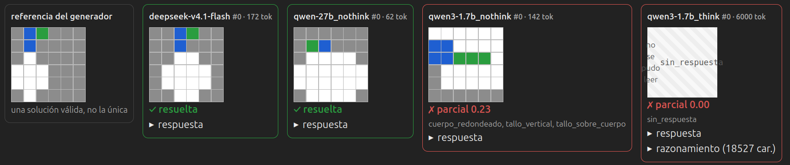

# PixelDraw — Detalles

Este documento explica las decisiones de diseño del entorno y por qué se tomaron. Para instalar y usar el entorno, ver el [README](../README.md).

## Niveles

| Nivel | Qué pide | Respuesta | Qué verifica |
|---|---|---|---|
| L0 | Relleno: mitades, franjas, borde | Única | Igualdad por región de color |
| L1 | Una forma en una posición absoluta: punto, rectángulo, línea, marco, cruz | Única | Igualdad por región de color |
| L2 | 2–3 formas con relaciones: izquierda/derecha/arriba/abajo, toca, no toca, dentro de un marco | Abierta | Cada color forma exactamente su figura y cada relación se cumple |
| L3 | Restricciones globales: k copias que no se tocan, figura simétrica de n celdas, conteos de dos colores sin vecindad | Abierta | Conteos, conectividad, simetría, vecindad |
| L4 | Concepto con receta explícita (manzana, casa, árbol, semáforo; sol solo en test_ood), con colores dados y región opcional | Abierta | Gramática del concepto: formas y relaciones entre sus partes |
| L5 | Concepto implícito ("dibuja un árbol reconocible") | Abierta | La misma gramática, más permisiva, probando todas las asignaciones de colores posibles a las partes |

El tamaño de la grilla (6, 8, 12; 10 y 16 en test_ood) es un segundo eje de dificultad, independiente del nivel.

## Splits

| Split | Total | L0 | L1 | L2 | L3 | L4 | L5 |
|---|---:|---:|---:|---:|---:|---:|---:|
| train | 6.139 | 1.200 | 1.200 | 1.200 | 1.200 | 1.200 | 139 |
| eval | 738 | 141 | 150 | 150 | 145 | 144 | 8 |
| test | 1.471 | 273 | 297 | 300 | 291 | 295 | 15 |
| test_ood | 1.450 | 200 | 200 | 200 | 200 | 490 | 160 |

- **Distribución.** train, eval y test usan grillas de 6, 8 y 12. `test_ood` usa grillas de 10 y 16, y además el concepto *sol*, que no aparece en los otros splits.
- **Sin fugas.** La deduplicación usa el enunciado sin el ejemplo de formato (`core_id`), así que ninguna tarea aparece en dos splits ni siquiera con otro ejemplo.
- **Limpieza.** Durante el desarrollo, el verificador se ajustó mirando las respuestas a dos conjuntos de calibración de 540 tareas, que compartían enunciados con los splits.

## Formato de respuesta

El prompt pide el formato disperso, pero el verificador también acepta la grilla densa (`python -m pixeldraw.generate --format grid` genera prompts que la piden).

**Disperso.** Se declara el fondo y se listan solo las celdas pintadas, con tramos opcionales: `(f,c1-c2)` es un tramo de fila, `(f1-f2,c)` uno de columna y `(f1-f2,c1-c2)` un bloque. También se acepta la notación de esquina a esquina `(f1,c1)-(f2,c2)`.

```
<answer>
fondo: blanco
rojo: (2,3) (2,4) (3,3-5)
azul: (5-6,1)
</answer>
```

**Por qué no la grilla densa.** Con la grilla densa, Qwen3-1.7B sin razonamiento respondió la grilla en blanco en el 57% de las muestras, incluso en tareas con figuras, y quedó en ~0% en todos los niveles: copiaba la forma de la respuesta e ignoraba el contenido. En el formato disperso no dibujar nada queda explícito, y el modelo razona en coordenadas en vez de llenar una matriz.

**Ejemplo concreto en cada prompt.** Cada prompt trae un ejemplo del formato con otro dibujo, otros colores y otras coordenadas, en vez de una plantilla con marcadores. Con `<color>: (f,c)…`, el 1.7B copiaba los marcadores literalmente. El generador garantiza que copiar el ejemplo da recompensa 0, binaria y parcial, y la batería de tests lo comprueba en todas las tareas.

**Estricto donde importa.** Exactamente una línea `fondo:`, solo líneas `color: (f,c)…`, coordenadas dentro de 1..N y rangos crecientes; cualquier otra cosa invalida la respuesta. Si una celda aparece dos veces, vale la última línea.

## Verificador - Sin clasificador de imágenes

El verificador es la pieza central del entorno. En aprendizaje por refuerzo el modelo optimiza exactamente lo que el verificador premia. Si acepta una respuesta incorrecta, el modelo aprende a producir esa respuesta. Por eso no se evalúa si el dibujo "se parece" a algo, sino si cumple, una por una, las restricciones de la tarea.

### Por qué no un clasificador de imágenes

La alternativa obvia sería renderizar la grilla y preguntarle a un clasificador (por ejemplo, CLIP) si ve una manzana. Se descartó por estas razones:

1. **Eficiencia.** GRPO genera varias respuestas por prompt en cada paso, y cada una hay que calificarla. Un clasificador como CLIP necesita GPU y tarda por respuesta. En cambio, el verificador corre en milisegundos, sin GPU y siempre da el mismo resultado.
2. **No tiene sentido en grillas tan chicas.** Las grillas van de 6×6 a 12×12, es decir, de 36 a 144 píxeles. Los clasificadores se entrenan con fotos e ilustraciones, y con imágenes así sus puntajes serían casi ruido.
3. **No puede revisar la tarea completa.** Las tareas piden posiciones exactas, conteos, colores y relaciones ("a la izquierda de", "sin tocarse"), justo lo que los clasificadores hacen peor.
4. **Se puede engañar y no explica el fallo.** Un modelo entrenado con RL contra un clasificador tiende a encontrar cambios mínimos que lo engañan, en vez de aprender a dibujar. Además, un clasificador solo entrega un número; el verificador dice qué restricción falló, lo que permite dar crédito parcial y auditar las respuestas.

El costo de esta decisión es que el verificador solo acepta lo que sus reglas describen: una manzana razonable que no cumpla la definición de "redondeado" se rechaza aunque se vea bien. Para reducir estos rechazos injustos se revisaron a mano los dibujos de los modelos que el verificador rechazaba en L5. Cuando el dibujo era razonable, se modificaron las regla para aceptar ese tipo de variante. Por ejemplo, ahora se aceptan semáforos horizontales y tallos más largos. En L4 las reglas siguen siendo estrictas, porque ahí el prompt da la receta exacta.

### Cómo califica una respuesta

Al generar cada tarea, el generador guarda también su especificación (`spec`): la lista de restricciones que debe cumplir el dibujo. El verificador nunca compara con un dibujo de referencia, así que **cualquier** dibujo que cumpla las restricciones recibe 1.0.



Ejemplo con una respuesta incorrecta de Qwen3-1.7B sin razonamiento a la tarea `L4-6-3d57f2f934` de eval:

> *Dibuja una manzana sobre fondo gris: un cuerpo redondeado de color blanco, y un tallo vertical de color azul de 1 o 2 celdas apoyado justo encima del cuerpo (su celda inferior toca una celda de la fila superior del cuerpo), y una hoja de color verde de 1 a 3 celdas que toque el tallo (puede ser en diagonal). […] No uses otros colores.*

```text
<answer>
fondo: gris
blanco: (1,1)-(1,3) (1,4)-(1,6) (2,2)-(2,4) (2,5)-(2,6) (3,2)-(3,4) (3,5)-(3,6) (4,2)-(4,4) (4,5)-(4,6) (5,2)-(5,4) (5,5)-(5,6)
azul: (2,1)-(2,2) (3,1)-(3,2)
verde: (3,3)-(3,5)
</answer>
```

**1. Parser: texto → grilla.** Toma el último bloque `<answer>` (lo que esté dentro de `<think>` se ignora) y lo convierte en una grilla de 6×6. Aquí el modelo escribe los tramos con la notación de esquina a esquina, `(1,1)-(1,3)`, que el parser acepta como equivalente a `(1,1-3)`. Si una celda aparece en dos líneas, vale la última: el tallo azul y la hoja verde pisan celdas que antes eran blancas. El parser también acepta el color por índice, colores en femenino o plural, grilla densa y JSON. Rechaza lo ambiguo o inválido: dos líneas `fondo:`, coordenadas fuera de la grilla o un `<think>` sin cerrar. Una respuesta que no se puede leer recibe 0.

```text
      c1 c2 c3 c4 c5 c6
f1     B  B  B  B  B  B      · gris   B blanco
f2     A  A  B  B  B  B      A azul   V verde
f3     A  A  V  V  V  B
f4     ·  B  B  B  B  B
f5     ·  B  B  B  B  B
f6     ·  ·  ·  ·  ·  ·
```

**2. Restricciones: grilla y lista de verificaciones.** Todo se revisa con geometría simple sobre las celdas: regiones conectadas de cada color, formas exactas, posiciones, conteos, contacto entre partes y las reglas de cada concepto.

| Restricción | Tipo | Resultado |
|---|---|---|
| `cuerpo_redondeado` | sustantiva | ✗ el blanco ocupa casi toda la grilla, con el tallo y la hoja incrustados: no es un cuerpo relleno con las esquinas recortadas |
| `tallo_vertical` | sustantiva | ✗ el azul es un bloque de 2×2, no una línea vertical de 1 o 2 celdas |
| `tallo_sobre_cuerpo` | sustantiva | ✗ el tallo está dentro del cuerpo, no apoyado encima |
| `hoja_junto_al_tallo` | sustantiva | ✓ la hoja verde toca el tallo en (3,3) |
| `sin_colores_extra` | higiene | ✓ |

Cada restricción es **sustantiva** (lo que pide la tarea: formas, posiciones, relaciones, conteos) o **de higiene** (usar solo los colores permitidos y quedarse dentro de la región). La diferencia importa en el crédito parcial, es decir: las sustantivas dan el crédito y las de higiene solo lo descuentan, porque una grilla vacía las cumple sin dibujar nada.

**3. Recompensa.**
- `reward` es binaria: 1.0 solo si se cumplen **todas** las restricciones. Aquí es 0.
- `reward_partial` da crédito por lo que sí se cumple, para que GRPO tenga señal en tareas que el modelo casi nunca resuelve. Si la tarea no está resuelta:

  reward_partial = 0,9 · max(0, (s − b)/(1 − b)) · (0,5 + 0,5·h)

  - **s** es la fracción de restricciones sustantivas cumplidas (forma, posición, relaciones, conteos). Aquí, 1 de 4: s = 0,25.
  - **b** es el puntaje que se obtiene sin dibujar nada, pintando toda la grilla de un color. Aquí, b = 0. Restarlo evita premiar respuestas triviales.
  - **h** es la fracción de restricciones de higiene cumplidas (colores permitidos, región). Aquí, h = 1. Violarlas descuenta hasta la mitad, pero no anula lo demás.
  - **0,9** es el tope: una respuesta incorrecta nunca vale lo mismo que una correcta.

    Resultado: 0,9 × 0,25 × 1 = **0,225**.

Cada pieza de la fórmula corrige un abuso que encontramos al probarla:
- sin el piso b, una grilla de un solo color sacaba 0,8 en las tareas de simetría;
- sin separar la higiene, cualquier dibujo de dos colores sacaba 0,2 en la casa de L5;
- sin el tope, una respuesta con colores extra podía valer lo mismo que una correcta.

### Cómo sabemos que no se equivoca

Un verificador puede fallar de dos maneras, y no son igual de graves:
- **Falso positivo:** acepta una respuesta incorrecta. Es el error grave, porque RL lo refuerza.
- **Falso negativo:** rechaza una respuesta correcta. Solo se pierde señal en ese caso, sin enseñar nada incorrecto.

Por eso el verificador es estricto por diseño, y lo ponemos a prueba en las dos direcciones. `python -m tests.verifier_suite data/eval.jsonl` corre 83.228 casos sin fallas:
- **contra falsos negativos:** la referencia de cada tarea, 31 formas equivalentes de escribirla, soluciones alternativas válidas y 24 dibujos reales de modelos revisados a mano
- **contra falsos positivos:** mutaciones que rompen una restricción y casos adversariales (grillas vacías o uniformes, varias respuestas, la solución escondida en `<think>`, texto como "reward: 1.0", copiar el ejemplo del prompt, colores inventados).

Los falsos negativos que aparecieron con respuestas reales (colores en femenino, líneas vacías, comentarios, semáforos horizontales…) se corrigieron con reglas generales, no con casos puntuales, y cada uno quedó fijado como test.

## Tests

`python -m tests.verifier_suite data/eval.jsonl` sobre las 738 tareas de eval:

| Categoría | Casos | Fallas |
|---|---:|---:|
| Positivos (referencias) | 738 | 0 |
| Formatos equivalentes (15 densos + 16 dispersos por tarea: tramos, esquinas, femenino, comentarios, colores vacíos, sin etiquetas…) | 22.878 | 0 |
| Soluciones alternativas válidas (traslaciones, colores alternativos en L5) | 236 | 0 |
| Mutaciones que deben fallar | 1.895 | 0 |
| Adversariales (vacío, ruido, uniforme, tamaño incorrecto, dos grillas, solución solo en `<think>`, inyección "1.0", coordenadas fuera de rango, dos fondos, texto extra, color inventado, copiar el ejemplo del prompt, etc.) | 27.306 | 0 |
| Interfaz `reward(prompt, completion)` | 212 | 0 |
| Casos reales: dibujos de DeepSeek revisados a mano, con su veredicto | 24 | 0 |
| El ejemplo del prompt da crédito parcial 0 | 738 | 0 |
| Ninguna respuesta no resuelta supera 0,9 de crédito parcial | 29.201 | 0 |
| **Total** | **83.228** | **0** |

Sobre `data/test_ood.jsonl` (1.450 tareas) pasan los 163.954 casos. `python -m pytest` corre la misma batería sobre una muestra de eval, más pruebas unitarias de `probe_opencode`.

**Falsos negativos encontrados con respuestas reales del 1.7B y corregidos:**
- colores en femenino ("roja"), que dejaban como error de formato el 44% de las respuestas de L2;
- líneas de color vacías (`negro: -`), que rechazaban respuestas correctas de "pinta todo de un color";
- comentarios al final de línea;
- la notación de esquina a esquina `(f1,c1)-(f2,c2)`.

Cada uno quedó cubierto por un test de formato equivalente.

## Medición

`pixeldraw.probe` funciona con cualquier API compatible con OpenAI:

- `--no-think` agrega `/no_think` al prompt (Qwen3). Si el servidor no lo respeta, usa `--extra '{"chat_template_kwargs":{"enable_thinking":false}}'`.
- `--workers` debería coincidir con los slots del servidor (`-np` en llama.cpp).
- Con una API en la nube, la clave va en `PD_API_KEY`. Los errores del servidor (429, timeouts) se reintentan con espera exponencial (`--retries`). Si alguno igual falla, queda fuera del resumen, y basta relanzar el mismo comando para reintentarlo.
- `--per-cell N` toma N tareas por celda nivel × tamaño. Con la misma `--seed`, `probe` y `probe_opencode` eligen exactamente las mismas tareas.

**Cómo leer la calibración.** La zona útil para GRPO es la de tareas resueltas "a veces":
- si un nivel queda casi siempre en "nunca", conviene bajar el tamaño de la grilla o la cantidad de objetos y relaciones;
- si queda en "siempre", conviene subirlos;
- si la mayoría de los fallos son de formato, el problema es la escritura de la grilla y no el dibujo.

## Galerías

`pixeldraw.render` arma una página HTML autocontenida:
- una tabla de pass@1 por modelo y nivel;
- por cada tarea: el enunciado, el dibujo de referencia y las respuestas de cada modelo dibujadas, con su veredicto, las restricciones falladas y el texto de la respuesta.

```bash
python -m pixeldraw.render --tasks data/eval.jsonl --results "results/eval/*.jsonl" --out galeria.html
python -m pixeldraw.render --tasks data/train.jsonl --results "results/train/*.jsonl" \
    --levels L4 L5 --pick discrepan --png-dir figuras/ --out galeria_L4L5.html
python -m pixeldraw.render --tasks data/train.jsonl --sft derived/sft.jsonl --out galeria_sft.html
```

Opciones de selección:
- `--pick todas|fallidas|resueltas|discrepan`;
- `--levels`, `--families` y `--task-ids`;
- `--per-group`: tareas por nivel, familia y tamaño;
- `--samples`: muestras por modelo;
- `--px`: tamaño de celda.

La opción `--pick resueltas` sirve para auditar a mano una muestra de aciertos.

## Datos derivados

- **SFT** (`derived/sft.jsonl`, formato `messages`):
  - solo respuestas resueltas del profesor (`--sft-models`), recalificadas con el verificador actual;
  - sin truncadas y sin duplicados;
  - hasta 2 por tarea, las más cortas.
- **DPO** (`derived/dpo.jsonl`, `prompt` / `chosen` / `rejected`):
  - un par para cada tarea con al menos una respuesta correcta y una incorrecta;
  - como rechazo se prefieren las "casi correctas" (grilla legible y mayor crédito parcial), que son las comparaciones más informativas;
  - los rechazos del modelo objetivo hacen que los pares sean *on-policy* respecto del modelo base.
- Solo se usan tareas de train (`--allow-non-train` lo desactiva).
- `derived/stats.json` resume por nivel cuántas tareas tuvieron algún acierto y cuántas trazas y pares salieron.

| Nivel | Tareas | Con acierto del profesor | SFT | DPO |
|---|---:|---:|---:|---:|
| L0 | 30 | 30 | 60 | 21 |
| L1 | 30 | 30 | 59 | 13 |
| L2 | 120 | 120 | 238 | 100 |
| L3 | 120 | 120 | 239 | 82 |
| L4 | 120 | 120 | 240 | 180 |
| L5 | 115 | 91 | 165 | 178 |
| **Total** | | | **1.001** | **574** |

**Advertencia para DPO.** Las respuestas preferidas (DeepSeek) traen `<plan>` y las rechazadas (Qwen3-1.7B) no, porque el razonamiento del 1.7B no se incluye. Un entrenamiento DPO podría aprender a escribir un plan en vez de a dibujar mejor. Si eso importa, conviene quitar el `<plan>` de `chosen` o regenerar los rechazos con un modelo ya ajustado con SFT, que también escribe planes.

## Convenciones y limitaciones del verificador

- **"Redondeado"** exige esquinas recortadas, alto y ancho de al menos 3 y un relleno entre 55% y 95%.
- **L4 vs. L5.** En L4 la regla va en el prompt y se aplica estricta. En L5 (implícito), las gramáticas son más permisivas. Se ajustaron a partir de dibujos reales de DeepSeek que el verificador rechazaba sin razón:
  - el semáforo puede ser vertical u horizontal; en horizontal, el amarillo va al medio y el rojo en cualquier extremo, porque varía según el país;
  - la carcasa del semáforo puede tener las esquinas recortadas o estar abierta en los extremos, siempre que cada luz quede encerrada en el eje corto;
  - las luces pueden ser cuadradas o redondeadas, de hasta 16 celdas;
  - se admite un poste opcional: un rectángulo de hasta 2 columnas pegado bajo la carcasa;
  - el tallo de la manzana puede medir hasta la mitad de la altura del cuerpo, y la hoja hasta un tercio del cuerpo;
  - la casa admite aberturas (puerta y ventanas) de cualquier color, rectangulares, dentro del cuerpo y que no ocupen más de la mitad.
- **Lo que sigue rechazándose** son dibujos que no se leen como el objeto: una manzana de proporción 2:1, un cuerpo cuadrado con protuberancias, luces que ocupan todo el ancho del semáforo o que se superponen.
- **L0 y L1 tienen respuesta única.** Sirven de ancla para medir el control de la grilla, más que como tareas abiertas.
